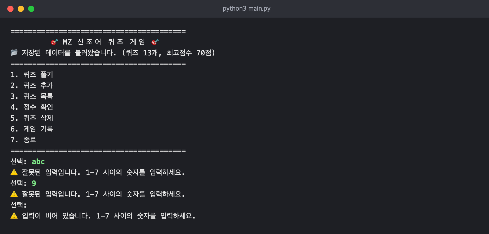
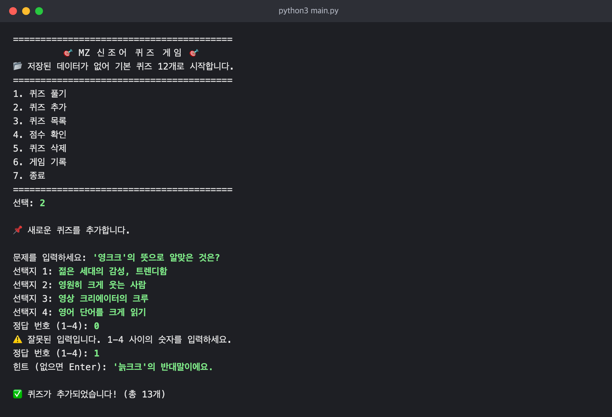
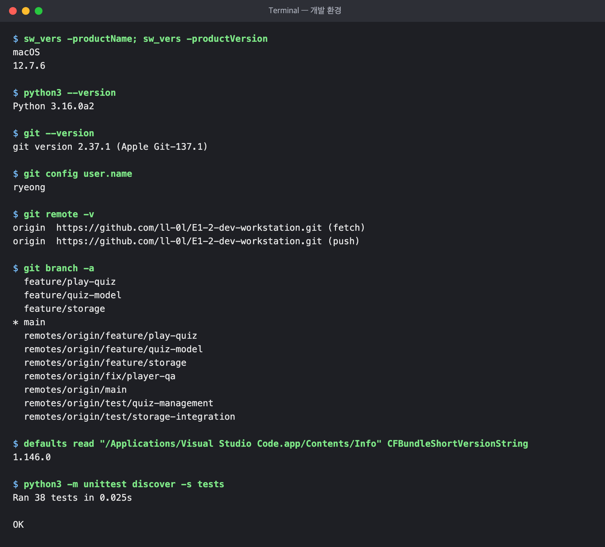
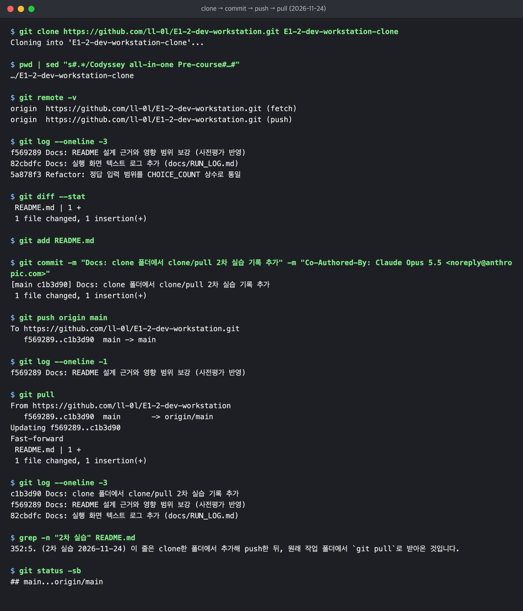

# 🎯 MZ 신조어 퀴즈 게임

[](https://github.com/ll-0l/E1-2-dev-workstation/actions/workflows/ci.yml)

터미널에서 즐기는 **2026 MZ·잘파세대 신조어** 4지선다 퀴즈 게임입니다.
Python 표준 라이브러리만으로 만들었고, 추가한 퀴즈와 점수 기록은 `state.json`에 저장되어 프로그램을 다시 실행해도 그대로 남습니다.

- GitHub 저장소: https://github.com/ll-0l/E1-2-dev-workstation
- 실행 로그(텍스트): [docs/RUN_LOG.md](docs/RUN_LOG.md)
- Git 작업 증빙(텍스트): [docs/GIT_EVIDENCE.md](docs/GIT_EVIDENCE.md)
- 동료평가 대응표와 답변 정리: [docs/PEER_REVIEW.md](docs/PEER_REVIEW.md) · 쉬운 말 버전: [docs/PEER_REVIEW_EASY.md](docs/PEER_REVIEW_EASY.md)

## 목차
1. [프로젝트 개요](#1-프로젝트-개요)
2. [퀴즈 주제와 선정 이유](#2-퀴즈-주제와-선정-이유)
3. [실행 방법](#3-실행-방법)
4. [기능 목록](#4-기능-목록)
5. [파일 구조와 설계](#5-파일-구조와-설계)
6. [데이터 파일 설명 (state.json)](#6-데이터-파일-설명-statejson)
7. [실행 화면](#7-실행-화면)
8. [요구사항 변경 시 영향 범위](#8-요구사항-변경-시-영향-범위)
9. [개발 과정 (Git)](#9-개발-과정-git)

## 1. 프로젝트 개요

| 항목 | 내용 |
|---|---|
| 형태 | Python 콘솔(터미널) 프로그램 |
| 실행 환경 | Python 3.10 이상, 외부 라이브러리 없음 |
| 핵심 기능 | 퀴즈 풀기 · 추가 · 목록 · 점수 확인 · 삭제 · 게임 기록 |
| 데이터 저장 | 프로젝트 루트의 `state.json` (UTF-8) |
| 구조 | `Quiz` · `QuizSession` · `QuizGame` · `StateStorage` 4개 클래스 + 입력 함수 모듈 `input_utils` |
| 테스트 | `unittest` 단위 테스트 61개 (5-5 테스트 매핑 참고), GitHub Actions에서 Python 3.10·3.12·3.13 자동 점검 (9-6) |

## 2. 퀴즈 주제와 선정 이유

**주제: 2026년 MZ·잘파세대 신조어·유행어**

> MZ세대와 원만하게 소통하기 위한 사전학습.
> **'늙크크'(올드한 감성)**가 되지 않기 위한 몸부림입니다.

요즘 SNS와 커뮤니티에서는 '감다살', '밤티', '기대컨'처럼 처음 들으면 뜻을 짐작하기 어려운 말이 계속 생겨납니다.
대화에서 매번 뜻을 묻는 대신 게임으로 가볍게 익혀 보려고 이 주제를 골랐습니다.

### 기본 문제 12개 선정 기준
| 기준 | 적용 내용 |
|---|---|
| 출처 | 아시아투데이 [「[카드뉴스] 2026 상반기 신조어 총정리…'신조어 활용 가이드'」](https://www.asiatoday.co.kr/kn/view.php?key=20260723001638281) (2026.07.24)에 실린 24개 표현 중에서만 선정 |
| 제외 | 욕설을 순화한 말(샤갈), 특정 집단을 비하할 수 있는 말(멘헤라) 등 퀴즈로 내기 부적절한 표현은 제외 |
| 중복 | 한 용어당 1문제, 같은 문제 문장 없음 (12문제 모두 서로 다른 용어) |
| 정답 분산 | 정답 번호가 한쪽에 몰리지 않게 1번 3개 · 2번 3개 · 3번 4개 · 4번 2개로 배치 |
| 선택지 | 오답도 그럴듯한 뜻으로 작성하고, 문제 안의 선택지 길이 차이를 6자 이내로 맞춰 정답이 눈에 띄지 않게 함 |
| 난이도 | 별도 등급은 두지 않음. 대신 모든 문제에 힌트를 넣어, 처음 보는 용어도 추론해서 풀 수 있게 함 |

### 기본 퀴즈 교체 절차
기본 퀴즈는 `default_quizzes.py`의 `_DEFAULT_QUIZ_DATA` 목록 한 곳에만 있습니다. ① 이 목록의 dict(문제, 선택지 4개, 정답 번호, 힌트)를 고치고 → ② `python3 scripts/validate_quizzes.py`로 형식(5개 이상, 선택지 4개, 정답 1~4, 힌트, 중복 문제·선택지)을 검사하고(오류가 있으면 번호와 이유를 알려 줌) `python3 -m unittest tests.test_quiz`까지 통과시킨 뒤 → ③ `state.json`을 지우고 실행하면 새 기본 퀴즈로 시작합니다. `state.json`이 있으면 저장된 퀴즈가 우선하므로, 기존 사용자의 데이터는 교체 후에도 그대로 유지됩니다.

## 3. 실행 방법

```bash
# 1. 저장소 복제
git clone https://github.com/ll-0l/E1-2-dev-workstation.git
cd E1-2-dev-workstation

# 2. Python 버전 확인 (3.10 이상)
python3 --version

# 3. 실행
python3 main.py

# (선택) 단위 테스트 실행
python3 -m unittest discover -s tests -v

# (선택) 변경 후 전체 점검: 문법 → 테스트 → 퀴즈 검증 → 실제 실행 (CI와 동일)
python3 scripts/run_checks.py

# (선택) 디버그 로그: 잘못된 입력·불러오기/저장 결과를 quiz_debug.log에 기록 (화면은 그대로)
QUIZ_DEBUG=1 python3 main.py
```

- 처음 실행하면 `state.json`이 없으므로 기본 퀴즈 12개로 시작하고 파일을 자동으로 만듭니다.
- 종료는 메뉴 `7`을 고르면 됩니다. `Ctrl+C`를 눌러도 저장한 뒤 안전하게 종료됩니다.

## 4. 기능 목록

### 메뉴
```
========================================
         🎯 MZ 신조어 퀴즈 게임 🎯
📂 저장된 데이터를 불러왔습니다. (퀴즈 13개, 최고점수 70점)
========================================
1. 퀴즈 풀기
2. 퀴즈 추가
3. 퀴즈 목록
4. 점수 확인
5. 퀴즈 삭제
6. 게임 기록
7. 종료
========================================
선택:
```

메뉴 항목은 `QuizGame.__init__`의 `self.menu_items` 리스트에 `(메뉴 이름, 실행할 메서드)` 쌍으로 정의되어 있습니다. `run()`은 입력받은 번호로 이 리스트에서 메서드를 꺼내 실행합니다.

| 번호 | 기능 | 담당 메서드 | 설명 |
|---|---|---|---|
| 1 | 퀴즈 풀기 | `QuizGame.play_quiz` → `QuizSession.play` | 풀 문제 수를 고르면 **랜덤 순서**로 출제합니다. 답할 때마다 정답/오답을 알려주고(오답이면 정답 공개), 끝나면 점수를 표시하고 최고 점수를 갱신합니다. |
| 2 | 퀴즈 추가 | `QuizGame.add_quiz` | 문제, 선택지 4개, 정답 번호(1-4), 힌트(선택)를 입력받아 새 퀴즈를 등록하고 바로 저장합니다. |
| 3 | 퀴즈 목록 | `QuizGame.list_quizzes` | 등록된 퀴즈를 번호와 함께 보여줍니다. 힌트가 있는 문제는 💡로 표시합니다. |
| 4 | 점수 확인 | `QuizGame.show_score` | 최고 점수와 그 판의 정답 수, 힌트 사용 횟수, 기록 일시를 보여줍니다. |
| 5 | 퀴즈 삭제 | `QuizGame.delete_quiz` | 번호를 고르고 y/n으로 확인한 뒤 삭제합니다. `0`을 입력하면 취소됩니다. |
| 6 | 게임 기록 | `QuizGame.show_history` | 최근 10판의 일시, 정답 수, 힌트, 점수를 최신순으로 보여주고 평균 점수를 함께 표시합니다. |
| 7 | 종료 | `QuizGame.quit` | 저장한 뒤 종료합니다. |

### 점수 규칙 (힌트 차감)
- 문제를 풀다가 `h`를 입력하면 힌트를 볼 수 있습니다.
- 힌트 없이 맞히면 배점의 100%, **힌트를 보고 맞히면 50%**, 틀리면 0점입니다.
- `점수 = 100 × (정답 수 − 0.5 × 힌트를 보고 맞힌 수) ÷ 출제 문항 수`를 소수점 첫째 자리에서 **반올림(사사오입)**합니다.
- 예: 5문제 중 4문제를 맞혔고 그중 1문제가 힌트 사용 → `100 × 3.5 ÷ 5` = **70점**
- 예: 8문제 중 5문제 정답 → 62.5 → **63점**
- 판이 끝날 때마다 최고 점수와 비교해서 **더 높을 때만** 갱신합니다(`QuizGame._record_result`).

### 입력·예외 처리
모든 숫자 입력은 `input_utils.read_int`, 문자열 입력은 `read_text`/`read_line`을 거칩니다.

| 상황 | 화면 메시지 | 처리 / 사용자 권장 조치 | 검증 테스트 |
|---|---|---|---|
| 입력 앞뒤 공백 (` 1 `) | (없음) | 공백을 지우고 정상 처리 | `test_read_line_strips_input`, `test_menu_rejects_text_out_of_range_and_empty_then_quits` |
| 숫자가 아닌 입력 (`abc`) | ⚠️ 잘못된 입력입니다. 1-7 사이의 숫자를 입력하세요. | 같은 질문을 다시 물음 | `test_read_int_retries_and_accepts_keyword_case_insensitively`, `test_menu_rejects_...` |
| 범위 밖 숫자 (메뉴 `9`, 정답 `0`) | ⚠️ 잘못된 입력입니다. (범위) 사이의 숫자를 입력하세요. | 같은 질문을 다시 물음 | `test_menu_rejects_...` |
| 빈 입력 (Enter) | ⚠️ 입력이 비어 있습니다. 1-7 사이의 숫자를 입력하세요. / ⚠️ 입력이 비어 있습니다. 내용을 입력하세요. | 같은 질문을 다시 물음 | `test_read_text_retries_empty_input`, `test_menu_rejects_...` |
| `Ctrl+C` / 입력 스트림 종료(EOF) | ⚠️ 입력이 중단되어 프로그램을 종료합니다. | 저장 후 정상 종료(트레이스백 없음) | `test_keyboard_interrupt_saves_and_exits_without_traceback`, `test_eof_saves_and_exits_without_traceback` |
| 퀴즈 0개 상태에서 풀기·목록·삭제 | 📭 등록된 퀴즈가 없습니다. | '퀴즈 추가'로 먼저 등록 | `test_delete_returns_without_input_when_empty` |
| 플레이 기록 없이 점수·기록 확인 | 📭 아직 퀴즈를 풀지 않았습니다. / 게임 기록이 없습니다. | '퀴즈 풀기'로 첫 기록 생성 | `test_show_history_handles_empty_history` |
| `state.json` 없음 (첫 실행) | 📂 저장된 데이터가 없어 기본 퀴즈 12개로 시작합니다. | 기본 퀴즈로 시작하고 파일 생성 | `test_missing_state_saves_default_quizzes`, `test_missing_file` |
| `state.json` 손상 (JSON 문법 오류, 선택지 3개 등) | ⚠️ 데이터 파일이 손상되어 기본 퀴즈로 복구합니다. (원본은 state.json.bak에 백업) | 기본 퀴즈로 복구, 원본은 `.bak`으로 보관 → [6-5](#6-5-손상-파일-백업-정책) | `test_malformed_json_is_backed_up`, `test_invalid_quiz_is_backed_up_as_corrupted`, `test_corrupted_state_resets_runtime_state_and_saves` |
| `state.json` 읽기 오류 (권한 등) | ⚠️ 데이터 파일을 읽을 수 없어 기본 퀴즈로 시작합니다. (기존 파일 보호를 위해 이번 실행 내용은 저장하지 않습니다) | **보호 모드**: 이번 실행 동안 저장을 모두 생략해 원본을 덮어쓰지 않음. 권한(`ls -l state.json`)을 고친 뒤 다시 실행 | `test_read_error_blocks_all_later_saves`, `test_load_os_error` |
| 더 새로운 버전 프로그램이 만든 `state.json` | ⚠️ 데이터 파일이 더 새로운 버전의 프로그램에서 만들어졌습니다. (…저장하지 않습니다) | 손상으로 보지 않고 백업·덮어쓰기 없이 **보호 모드**. 최신 버전 프로그램으로 실행 | `test_future_version_is_unsupported_and_left_untouched`, `test_unsupported_version_enters_read_only_mode` |
| `state.json` 쓰기 오류 | ⚠️ 데이터를 파일에 저장하지 못했습니다. + 조치 안내 2줄 (+ 추가·삭제 직후면 "이번 실행 중에만 유지" 1줄) | 기존 파일은 보존됨 → [6-4](#6-4-저장-흐름과-저장-실패-시-복구-절차) | `test_save_serializes_quizzes_and_reports_failure`, `test_save_replace_error_removes_temporary_file`, `test_add_quiz_warns_when_save_fails` |

> 위 상황들의 실제 실행 원문은 [docs/RUN_LOG.md 4장 "예외 흐름 사례"](docs/RUN_LOG.md#4-예외-흐름-사례)에 8가지 사례로 정리했습니다.

### 안내 문구 형식 (표준)
모든 안내는 **맨 앞 아이콘으로 종류를 구분**하고, 경고는 항상 "무엇이 문제인지 → 무엇을 하면 되는지" 순서로 씁니다. 새 메시지를 추가할 때도 이 형식을 따릅니다.

| 아이콘 | 종류(수준) | 형식 | 예시 |
|---|---|---|---|
| ⚠️ | 입력 오류 (경고, 재입력) | `⚠️ {문제}. {해야 할 입력}.` | ⚠️ 잘못된 입력입니다. 1-4 사이의 숫자를 입력하세요. |
| ⚠️ | 데이터 파일 문제 (경고, 자동 처리) | `⚠️ {문제}되어 {프로그램이 한 처리}. ({부가 정보})` | ⚠️ 데이터 파일이 손상되어 기본 퀴즈로 복구합니다. (원본은 state.json.bak에 백업) |
| ⚠️ | 저장 실패 (오류, 사용자 조치 필요) | 1줄 `⚠️ {문제}.` + 들여쓴 `→ {조치}` 줄들 | ⚠️ 데이터를 파일에 저장하지 못했습니다.<br>   → …쓰기 권한과 디스크 여유 공간을 확인한 뒤 다시 실행해 주세요. |
| 📭 | 빈 상태 (안내) | `📭 {없는 것}. '{메뉴}'에서/로 {다음 행동}` | 📭 등록된 퀴즈가 없습니다. '퀴즈 추가'에서 먼저 퀴즈를 등록하세요. |
| 📂 | 데이터 불러오기 결과 (정보) | `📂 {결과}. ({요약})` | 📂 저장된 데이터를 불러왔습니다. (퀴즈 13개, 최고점수 70점) |
| ✅ / 🗑️ / ↩️ | 작업 완료 / 삭제 / 취소 | `{아이콘} {무엇이} {어떻게 됐는지}. ({현재 개수})` | ✅ 퀴즈가 추가되었습니다! (총 13개) |
| ✅ / ❌ / 💡 | 정답 / 오답 / 힌트 | 오답이면 정답 번호와 내용을 함께 표시 | ❌ 오답입니다. 정답은 1번 (…)입니다. |
| 🎉 / 🏆 | 점수 갱신 / 현재 최고 점수 | | 🎉 새로운 최고 점수입니다! |

입력 오류 문구는 `input_utils.read_int`/`read_text`와 `QuizGame._confirm` 세 곳에서만 만들어, 화면마다 문구가 달라지지 않게 했습니다.

**입력 질문(프롬프트) 형식** — 메뉴와 모든 입력 질문은 `{질문} ({허용 값}): ` 모양으로 끝나, 무엇을 넣어야 하는지 질문 안에서 알 수 있게 했습니다.

| 화면 | 프롬프트 | 허용 값 표시 |
|---|---|---|
| 메뉴 | `선택: ` | 메뉴 번호가 바로 위에 나열됨 |
| 문제 수 | `몇 문제를 풀까요? (1-12): ` | 범위 |
| 정답 | `정답 입력 (1-4, 힌트: h): ` | 범위 + 특수 키 |
| 퀴즈 추가 | `정답 번호 (1-4): `, `힌트 (없으면 Enter): ` | 범위 / 생략 가능 여부 |
| 삭제 | `삭제할 퀴즈 번호 (1-13, 취소: 0): `, `이 퀴즈를 삭제할까요? (y/n): ` | 범위 + 취소 키 / 선택지 |

## 5. 파일 구조와 설계

### 5-1. 파일 구조
```
E1-2-dev-workstation/
├── main.py              # 실행 파일 (QuizGame().run())
├── quiz.py              # Quiz: 문제 1개 (출력, 정답 확인, dict 변환)
├── default_quizzes.py   # 기본 신조어 퀴즈 12개
├── quiz_session.py      # QuizSession: 1회 플레이 (랜덤 출제, 힌트, 채점)
├── quiz_game.py         # QuizGame: 메뉴 흐름, 퀴즈 관리, 점수 기록, 저장 시점
├── storage.py           # StateStorage: state.json 읽기/쓰기, 손상 감지와 백업
├── input_utils.py       # 공통 입력 검증 함수 (공백 제거, 숫자/범위/빈 입력 처리)
├── tests/               # unittest 단위 테스트 (61개, 5-5 참고)
├── scripts/
│   ├── run_checks.py         # 변경 후 자동 점검: 문법 → 테스트 → 퀴즈 검증 → 실행 (CI와 동일)
│   ├── validate_quizzes.py   # 기본 퀴즈/state.json 퀴즈 형식 검증 (2장)
│   ├── restore_backup.py     # state.json.bak 검사·복원 (6-5)
│   └── benchmark_storage.py  # 기록 수별 state.json 크기/저장 시간 측정 (6-7)
├── .github/workflows/ci.yml  # GitHub Actions: Python 3.10/3.12/3.13에서 run_checks.py 실행
├── docs/
│   ├── screenshots/     # 실행 화면 · 개발 환경 · git log 스크린샷
│   ├── RUN_LOG.md       # 실행 화면 텍스트 로그
│   ├── GIT_EVIDENCE.md  # 원격 저장소 · 커밋 · 브랜치/병합 · clone/pull 텍스트 증빙
│   ├── PEER_REVIEW.md   # 동료평가 항목 대응표와 답변 정리
│   ├── PEER_REVIEW_EASY.md  # 동료평가 쉬운 말 버전 (비유·시연 대본·용어 사전)
│   └── CONTRIBUTING.md  # 브랜치 이름 규칙과 병합 전 리뷰 체크리스트
├── AGENTS.md, CLAUDE.md # 개발 협업 규칙 (9장 참고)
├── .gitignore
├── README.md
└── state.json           # 실행 시 자동 생성 (Git에는 올리지 않음)
```

### 5-2. 클래스 역할과 주요 메서드
| 클래스 | 파일 | 책임 (한 문장) | 주요 메서드 → 하는 일 |
|---|---|---|---|
| `Quiz` | quiz.py | 문제 1개의 데이터와 규칙을 가진다 | `__init__` → 형식 검증 · `display` → 문제 출력 · `is_correct` → 정답 판정 · `to_dict`/`from_dict` → 저장용 변환 |
| `QuizSession` | quiz_session.py | 퀴즈 한 판을 진행하고 채점한다 | `__init__` → 섞기·문항 수 선택 · `play` → 출제·힌트·정답 안내 후 결과 dict 반환 · `calculate_score` → 점수 계산 |
| `QuizGame` | quiz_game.py | 게임 전체 상태를 관리하고 언제 무엇을 할지 정한다 | `run` → 메뉴 루프·중단 처리 · `play_quiz`/`add_quiz`/`list_quizzes`/`show_score`/`delete_quiz`/`show_history` → 메뉴 기능 · `_record_result` → 최고 점수 갱신 · `load`/`save` → 저장 시점 결정 |
| `StateStorage` | storage.py | `state.json` 파일을 안전하게 읽고 쓴다 | `load` → 읽기·검증·상태값 반환 · `save` → 임시 파일에 쓴 뒤 교체 · `_backup_corrupted_file` → 손상본 백업 |

**책임 경계 — 하는 일과 하지 않는 일**

| 클래스 | 하는 일 | 하지 않는 일 (다른 곳 담당) |
|---|---|---|
| `Quiz` | 자기 형식 검증, 문제 출력, 정답 판정 | 사용자 입력 받기(`QuizSession`), 파일 저장(`StateStorage`) |
| `QuizSession` | 출제 순서 섞기, 정답·힌트 입력 받기, 한 판의 점수 계산, 결과 dict 반환 | 최고 점수 비교·기록 누적(`QuizGame`), 파일 저장 |
| `QuizGame` | 메뉴 흐름, 퀴즈 목록 관리, 최고 점수·기록 갱신, **언제 저장할지** 결정, 사용자 안내 문구 | 파일을 **어떻게** 쓰는지(`StateStorage`), 채점 공식(`QuizSession`) |
| `StateStorage` | 파일 읽기/쓰기, 형식 검증, 손상본 백업, 결과를 상태값으로 반환 | 화면 출력, `Quiz` 객체 생성 (dict만 다룸) |

예를 들어 퀴즈 한 판이 끝나면 `QuizSession.play()`는 점수가 담긴 dict를 **돌려주기만** 하고, 그 점수를 최고 점수와 비교해 기록에 넣는 일(`_record_result`)과 저장(`save`)은 `QuizGame`이 합니다.

**클래스 관계도** (화살표 = "사용한다")
```
                         main.py
                            │ QuizGame().run()
                            ▼
  ┌───────────────────── QuizGame ─────────────────────┐
  │ quizzes: list[Quiz]   best_score   history   read_only │
  └──┬─────────────┬───────────────┬───────────────┬──┘
     │ 보관·생성    │ 한 판 진행      │ 메뉴·추가 입력   │ 읽기/쓰기 (dict만)
     ▼             ▼               ▼               ▼
   Quiz ◀─출제── QuizSession ───▶ input_utils     StateStorage ──▶ state.json
  (문제 1개)     (채점, 결과 dict)  (정답 입력 검증)  (검증·백업·버전 변환)
```
처음 읽을 때는 `main.py` → `QuizGame.run()` → 메뉴 메서드 순서로 따라가면 전체 흐름이 보입니다.

**오류 전파 정책 — 어떤 문제를 어디서 처리하나**

| 문제 | 처음 발생하는 곳 | 처리하는 곳 | 처리 방식 |
|---|---|---|---|
| 잘못된 입력 (빈 값, 문자, 범위 밖) | `input()` | `input_utils` | 그 자리에서 안내 후 재입력. 위로 올리지 않음 |
| Ctrl+C / EOF | `input()` | **`QuizGame.run`만** | `input_utils`·`QuizSession`은 잡지 않고 그대로 전달 → `run`이 저장 후 종료 |
| 잘못된 퀴즈 값 (선택지 3개 등) | `Quiz.__init__` | 호출한 쪽 | `ValueError` 발생 → `QuizGame._apply_state`는 손상으로 처리 |
| 파일 없음·손상·권한·미래 버전 | `StateStorage` | `StateStorage` → `QuizGame.load` | 예외를 밖으로 던지지 않고 상태값으로 변환 → `QuizGame`이 안내·복구·보호 모드 결정 |
| 저장 실패 | `StateStorage.save` | `QuizGame.save` | `False`를 받아 안내 문구 출력, 게임은 계속 |

원칙: **사용자에게 말하는 일은 `QuizGame`과 `input_utils`만**, **종료 결정은 `QuizGame.run`만** 합니다.

### 5-3. 클래스를 사용한 이유 (함수만 쓸 때와 비교)
- **데이터와 동작을 한곳에 묶습니다.** 퀴즈를 dict로만 다루면 `quiz["answer"]` 같은 키 접근과 정답 확인 함수가 여러 파일에 흩어집니다. `Quiz` 클래스는 문제·선택지·정답(속성)과 출력·정답 확인(메서드)을 함께 가지고 있어, 퀴즈 관련 코드를 `quiz.py` 한 곳에서 찾을 수 있습니다.
- **잘못된 데이터가 생기지 않게 막습니다.** `Quiz.__init__`이 생성 시점에 "선택지 4개, 정답 1~4"를 검사합니다. 그래서 프로그램 어디서든 `Quiz` 객체라면 형식이 올바르다고 믿고 쓸 수 있습니다.
- **상태를 계속 기억합니다.** 퀴즈 목록, 최고 점수, 기록은 프로그램이 도는 동안 유지되어야 합니다. 함수만 쓰면 전역 변수를 쓰거나 매번 인자로 넘겨야 합니다. `QuizGame`은 이 값들을 `self.quizzes`, `self.best_score`, `self.history` 속성으로 보관하고, 모든 메서드가 `self`로 같은 상태를 공유합니다.
- **부품을 바꿔 끼우기 쉽습니다.** `QuizGame(storage=StateStorage(임시경로))`처럼 저장소 객체를 넘겨받기 때문에, 테스트에서는 실제 `state.json` 대신 임시 파일을 씁니다. 나중에 저장 방식을 바꿀 때도 `StateStorage`만 교체하면 됩니다.
- **단점도 있습니다.** 파일과 코드량이 늘고, 처음 보는 사람은 클래스 사이의 관계를 먼저 이해해야 합니다. 그래서 **지켜야 할 상태가 없는 입력 검증은 클래스 없이 함수로 두었습니다**(`input_utils.py`). 상태와 규칙이 있으면 클래스로, 입력→출력만 있으면 함수로 나눈 것이 이 프로젝트의 기준입니다.

**Quick start — 클래스를 직접 써 보기** (진입 장벽을 낮추기 위한 예시, 프로젝트 폴더에서 `python3` 실행 후 입력)
```python
>>> from quiz import Quiz
>>> from quiz_session import QuizSession
>>> q = Quiz("'밤티'의 뜻은?", ["좋다", "별로다", "밤에 입는 티", "빛난다"], answer=2, hint="부정적인 평가예요")
>>> q.is_correct(2), q.is_correct(1)        # 메서드: 객체가 자기 정답으로 판정
(True, False)
>>> q.to_dict()["answer"]                    # 속성은 저장용 dict로 변환
2
>>> Quiz("문제", ["가", "나", "다"], 1)         # __init__이 잘못된 객체 생성을 막음
ValueError: 선택지는 정확히 4개여야 합니다.
>>> QuizSession.calculate_score(correct=4, hinted_correct=1, total=5)
70
```
게임 전체는 `QuizGame(StateStorage("다른경로/state.json")).run()`처럼 저장 위치를 바꿔 실행해 볼 수 있어, 실제 데이터를 건드리지 않고 연습할 수 있습니다.

### 5-4. 입력 검증과 데이터 입출력을 분리한 이유
- **바뀌는 이유가 다릅니다.** 입력 규칙(안내 문구, 허용 범위)은 화면 요구에 따라 바뀌고, 저장 방식(JSON → DB 등)은 데이터 요구에 따라 바뀝니다. 파일을 나눠 두면 한쪽을 고칠 때 다른 쪽을 건드리지 않습니다.
- **`StateStorage`는 화면에 아무것도 출력하지 않습니다.** 결과를 `"loaded"`/`"missing"`/`"corrupted"`/`"error"` 같은 상태값으로만 돌려주고, 사용자에게 어떤 메시지를 보여줄지는 `QuizGame.load`가 정합니다. 그래서 안내 문구를 바꿔도 저장 코드는 그대로입니다.
- **따로 테스트할 수 있습니다.** 입력 함수는 `input()`을 가짜로 바꿔(mock) 테스트하고, 저장소는 임시 폴더의 파일로 테스트합니다. 서로 의존하지 않아서 실패 원인을 바로 찾을 수 있습니다. 어떤 테스트가 어떤 책임을 검증하는지는 아래 5-5에 있습니다.

**경계 상황에서 두 쪽이 어떻게 맞물리나**

| 상황 | 입력 쪽 | 저장 쪽 | 결과 |
|---|---|---|---|
| 퀴즈 추가 중 정답 번호를 계속 틀리게 입력 | `read_int`가 올바른 값이 올 때까지 재입력 | 아직 호출되지 않음 | 검증을 통과한 값만 `Quiz`가 되어 저장됨 |
| 퀴즈 추가 중 문제만 쓰고 Ctrl+C | 입력 중단 신호를 그대로 전달 | `run`이 **추가 전 상태**를 저장 | 반쯤 입력한 퀴즈는 남지 않음 |
| 퀴즈 추가는 성공했는데 저장 실패 | 정상 | `save()`가 `False` | 목록에는 보이지만 "이번 실행 중에만 유지" 안내 |
| 보호 모드에서 퀴즈 추가 | 정상 | 저장 생략 | 위와 같은 안내, 원본 파일 그대로 |

### 5-5. 테스트 매핑 (책임 ↔ 테스트)
`python3 -m unittest discover -s tests -v`로 61개를 실행합니다. 실제 `state.json`은 건드리지 않고 모두 임시 폴더를 씁니다.

| 테스트 파일 | 검증하는 책임 | 개수 | 대표 테스트 |
|---|---|---:|---|
| `test_input_utils.py` | **입력 검증**: 공백 제거, 빈 입력·문자·범위 밖 재입력, 허용 키워드(`h`), EOF 전파, 디버그 로그 기록 | 6 | `test_read_int_retries_and_accepts_keyword_case_insensitively` |
| `test_quiz_game_run.py` | **메뉴 입력과 종료**: 메뉴 오입력 재요청, Ctrl+C/EOF 저장 후 종료, 저장 실패 안내, 재시작 후 유지 | 5 | `test_keyboard_interrupt_saves_and_exits_without_traceback` |
| `test_quiz.py` | **Quiz 규칙**: 생성 검증, 정답 판정, dict 변환, 기본 퀴즈 형식 | 5 | `test_validation_rejects_invalid_values` |
| `test_quiz_session.py` | **채점**: 점수 공식·사사오입, 문항 수 검증, 셔플 재현성, 힌트 1회 차감 | 5 | `test_score_rounds_half_up_at_half_point_boundaries` |
| `test_quiz_game_management.py` | **퀴즈 관리·기록**: 삭제 취소/확인/저장, 기록 최신순·평균·최고 표시, 최고 점수 갱신 조건, 기록 1,000건 롤링 | 8 | `test_record_result_updates_only_for_strictly_higher_score` |
| `test_storage.py` | **데이터 입출력**: 파일 없음, 손상 JSON·스키마 오류 백업, 백업 보존 정책, 수동 복구, UTF-8 왕복, 원자적 저장 실패, **버전 마이그레이션·미래 버전 보호·강제 종료 후 남은 임시 파일** | 17 | `test_migration_upgrades_old_version_step_by_step` |
| `test_quiz_game_storage.py` | **저장 연동**: load 상태별 처리(loaded/missing/corrupted/error/unsupported), 보호 모드, 저장 실패 안내 | 8 | `test_read_error_blocks_all_later_saves` |
| `test_validate_quizzes.py` | **퀴즈 검증 도구**: 기본 퀴즈 통과, 중복·힌트 누락·같은 선택지·형식 오류 검출, 개수 부족, 정답 쏠림 경고 | 4 | `test_detects_each_kind_of_error` |
| `test_restore_backup.py` | **백업 복원 도구**: 백업 없음, 손상된 백업 복원 거부, 정상 백업 복원과 이전 파일 보관 | 3 | `test_valid_backup_is_restored_and_current_file_kept` |

## 6. 데이터 파일 설명 (`state.json`)

### 6-1. 개요
| 항목 | 내용 |
|---|---|
| 경로 | 프로젝트 루트 `./state.json` (`storage.py`와 같은 폴더, `storage.DEFAULT_STATE_PATH`) |
| 인코딩 | UTF-8 (`ensure_ascii=False`라 한글이 그대로 저장됨) |
| 역할 | 퀴즈 목록, 최고 점수, 모든 게임 기록을 보관해서 다시 실행해도 유지 |
| 읽는 시점 | 프로그램 시작 시 1회 (`QuizGame.run` → `load`) |
| 쓰는 시점 | 첫 실행(파일 없음), 손상 복구 직후, 퀴즈 추가·삭제, 한 판 종료, 메뉴 종료, Ctrl+C/EOF 종료 |
| 안전 장치 | 임시 파일(`state.json.tmp`)에 먼저 쓴 뒤 `os.replace`로 교체해서, 저장 중 중단돼도 기존 파일이 깨지지 않음 |
| Git | 실행할 때마다 바뀌는 데이터라 `.gitignore`로 제외 |

**읽기/쓰기 시점 한눈에 보기** — 읽기는 시작할 때 한 번, 쓰기는 "데이터가 바뀌는 순간마다"입니다.

| 시점 | 읽기 | 쓰기 | 코드 |
|---|:---:|:---:|---|
| 프로그램 시작 | ✅ | 파일이 없거나 손상됐을 때만 ✅ | `QuizGame.run` → `load` |
| 퀴즈 추가 직후 | | ✅ | `add_quiz` → `_save_or_warn_unsaved` |
| 퀴즈 삭제 직후 | | ✅ | `delete_quiz` → `_save_or_warn_unsaved` |
| 한 판 종료(점수·기록 갱신) | | ✅ | `play_quiz` → `save` |
| 메뉴 7 종료 | | ✅ | `quit` → `save` |
| Ctrl+C / EOF 종료 | | ✅ | `run`의 `except` → `save` |
| 보호 모드(읽기 오류·미래 버전 파일) | | ❌ 모든 저장 생략 | `save`의 `read_only` 검사 |
| 목록·점수·기록 보기 | | (변경 없음 → 쓰지 않음) | |

> **동시 실행 안전성 요약**: 파일 잠금은 구현하지 않았습니다. **한 폴더에서는 게임을 하나만 실행**하는 것이 권장 설정이며, 이유와 대처법은 [6-8 운영 지침](#6-8-운영-지침-동시-실행과-데이터-관리)에 있습니다.

### 6-2. 스키마와 필드 설계 의도
```json
{
  "version": 1,
  "quizzes": [
    {
      "question": "'감다살'의 뜻으로 알맞은 것은?",
      "choices": ["감기가 다 나아서 살 것 같다", "감 다 살아있네, 센스가 좋다", "감자를 다 살 수 있다", "감정이 다 살아나서 울컥한다"],
      "answer": 2,
      "hint": "'감'은 감각·센스를 말해요. 칭찬할 때 써요."
    }
  ],
  "best_score": 70,
  "best_record": {
    "played_at": "2026-11-20T19:00:00", "total": 5, "correct": 4,
    "hints_used": 1, "hinted_correct": 1, "score": 70
  },
  "history": [
    {
      "played_at": "2026-11-20T19:00:00", "total": 5, "correct": 4,
      "hints_used": 1, "hinted_correct": 1, "score": 70
    }
  ]
}
```

| 필드 | 타입 | 설명 | 설계 의도 |
|---|---|---|---|
| `version` | int | 데이터 형식 버전 (현재 1) | 나중에 필드 구조가 바뀌면 버전을 보고 예전 파일을 변환(마이그레이션)할 수 있게 함 |
| `quizzes` | list | 퀴즈 목록 | 기본 퀴즈와 사용자가 추가한 퀴즈를 구분 없이 한 목록에 두어, 삭제·추가 결과가 그대로 유지되게 함 |
| `quizzes[].question` | str | 문제 (빈 문자열 불가) | |
| `quizzes[].choices` | list[str] | 선택지, 정확히 4개 | 선택지 순서가 곧 번호(1~4)라 순서를 보존하는 list 사용 |
| `quizzes[].answer` | int | 정답 번호 1~4 | 선택지 문자열이 아닌 번호로 저장해, 선택지 문구를 고쳐도 정답이 깨지지 않게 함 |
| `quizzes[].hint` | str | 힌트 (없으면 `""`) | 힌트가 없는 퀴즈도 같은 형태로 다루려고 `null` 대신 빈 문자열 사용 |
| `best_score` | int \| null | 최고 점수 0~100, 기록이 없으면 `null` | 0점과 "아직 안 풂"을 구분하려고 `null` 사용 |
| `best_record` | object \| null | 최고 점수를 낸 판의 상세 기록 | 점수 확인 화면에서 "5문제 중 4문제 정답, 힌트 1회"까지 보여주기 위함 |
| `history` | list | 모든 게임 기록 (오래된 순) | 보너스 '점수 기록 히스토리'용. 평균 점수와 최근 기록 표시에 사용 |
| `history[].played_at` | str | 플레이 일시 (ISO 8601) | JSON에는 날짜 타입이 없어 정렬 가능한 ISO 문자열로 저장 |
| `history[].total` / `correct` | int | 출제 문항 수 / 맞힌 수 | 문제 수를 고를 수 있어 판마다 분모가 다르므로 함께 저장 |
| `history[].hints_used` / `hinted_correct` | int | 힌트를 본 문제 수 / 힌트를 보고 맞힌 수 | 점수를 다시 계산·검증할 수 있도록 차감 근거를 남김 |
| `history[].score` | int | 점수 0~100 | 목록·평균 계산 때 매번 재계산하지 않도록 결과를 저장 |

형식이 하나라도 틀리면(선택지 3개, 정답 5번, `best_score`가 `true` 등) 손상된 파일로 판단합니다(`StateStorage._normalize_state`).

### 6-3. 불러오기 흐름 (`QuizGame.load`)
```
StateStorage.load()
 ├─ "loaded"    → Quiz 객체로 변환해 상태 복원 → "📂 저장된 데이터를 불러왔습니다 (퀴즈 N개, 최고점수 X점)"
 ├─ "missing"   → 기본 퀴즈 12개로 시작 → 즉시 저장해 state.json 생성
 ├─ "corrupted" → 손상본을 state.json.bak으로 복사 → 기본 퀴즈로 초기화 → 즉시 저장
 ├─ "unsupported" → (더 새 버전 파일) 기본 퀴즈로 시작, 보호 모드 → 이번 실행 동안 저장 안 함, 원본 그대로
 └─ "error"     → (권한 등 읽기 실패) 기본 퀴즈로 시작, 보호 모드 → 이번 실행 동안 저장 안 함
```
`StateStorage.load`는 어떤 경우에도 예외를 밖으로 던지지 않고 상태값만 돌려주므로, 파일 문제로 프로그램이 멈추지 않습니다.

### 6-4. 저장 흐름과 저장 실패 시 복구 절차
1. `QuizGame.to_state()`가 현재 상태를 dict로 만듭니다.
2. `StateStorage.save()`가 형식을 검증하고 `state.json.tmp`에 쓴 뒤, `os.replace`로 `state.json`과 바꿉니다.
3. 쓰기 중 오류가 나면 임시 파일을 지우고 `False`를 돌려줍니다. **기존 `state.json`은 바뀌지 않습니다.**
4. `QuizGame.save()`는 실패하면 아래처럼 안내합니다.
   ```
   ⚠️ 데이터를 파일에 저장하지 못했습니다.
      → state.json이 있는 폴더의 쓰기 권한과 디스크 여유 공간을 확인한 뒤 다시 실행해 주세요.
      → 기존 state.json은 그대로 남아 있어 마지막으로 저장된 상태는 보존됩니다.
      → 추가한 퀴즈는 이번 실행 중에만 유지되며, 종료하면 반영되지 않습니다.   ← 추가·삭제 직후일 때만
   ```
5. **사용자 복구 절차**: 프로그램을 종료하고 → 폴더 권한(`ls -l`)과 디스크 공간을 확인한 뒤 → 다시 실행하면 마지막으로 저장된 상태부터 이어집니다. 종료 중(Ctrl+C) 저장에 실패해도 같은 안내가 나옵니다. 실제 실행 원문: [RUN_LOG 4-8](docs/RUN_LOG.md#4-8-저장-불가-상태에서-퀴즈-추가--ctrlc)

**저장 실패 시 바로 할 일 (체크리스트)**
- [ ] 게임을 7번으로 종료한다 (안내가 나와도 기존 `state.json`은 안전함)
- [ ] 아래 표에서 원인을 확인하고 조치한다
- [ ] `python3 main.py`로 다시 실행해 "📂 저장된 데이터를 불러왔습니다"가 나오는지 확인한다
- [ ] 원인을 모르겠으면 `QUIZ_DEBUG=1 python3 main.py`로 실행 후 `quiz_debug.log`의 "저장 실패" 줄을 확인한다

| 상황 예시 | 확인 명령 | 즉시 조치 |
|---|---|---|
| 폴더에 쓰기 권한이 없음 (다른 계정으로 만든 폴더, 읽기 전용 폴더) | `ls -ld .` | `chmod u+w .` 또는 쓰기 가능한 폴더로 프로젝트를 옮겨 실행 |
| `state.json` 자체가 읽기 전용 | `ls -l state.json` | `chmod u+w state.json` |
| 디스크 공간 부족 | `df -h .` | 불필요한 파일 정리 후 재실행 |
| USB·네트워크 드라이브가 분리됨 | `ls` 결과가 비거나 오류 | 드라이브 재연결 후 재실행 |

**저장 도중 강제 종료되면?** 저장은 `state.json.tmp`에 먼저 쓰고 마지막에 한 번에 바꿔치기하므로, 도중에 꺼져도 `state.json`은 이전 상태 그대로입니다. 반쯤 쓴 `state.json.tmp`가 남을 수 있지만 프로그램은 이 파일을 읽지 않고, 다음 저장 때 덮어쓴 뒤 정리합니다 (`test_leftover_temp_file_from_crash_is_ignored_then_replaced`로 검증).

### 6-5. 손상 파일 백업 정책
- 손상을 감지하면 원본을 **`state.json.bak` 1개**로 복사한 뒤 기본 데이터로 복구합니다(`StateStorage._backup_corrupted_file`).
- **가장 최근 손상본 1개만 보관합니다.** 다시 손상이 감지되면 `.bak`을 새 손상본으로 덮어씁니다. 이전 백업을 남기려면 직접 다른 이름(예: `state.json.bak.1`)으로 복사해 두세요.
- 백업 파일도 실행 데이터라 `.gitignore`로 Git에서 제외합니다.
- **수동 복구 방법**: `state.json.bak`을 열어 잘못된 부분(예: 선택지 개수)을 고친 뒤 `state.json`으로 이름을 바꾸고 다시 실행합니다.
- **복원 도우미 스크립트**: `python3 scripts/restore_backup.py`가 `.bak`을 **검사**해 지금 불러올 수 있는지, 아니면 몇 번째 줄이 틀렸는지 알려 줍니다. 정상이면 `--restore`를 붙여 실행하면 현재 파일을 `state.json.before-restore`로 보관한 뒤 `.bak`으로 되돌립니다. 손상된 `.bak`은 복원하지 않습니다. (실행 원문: [RUN_LOG 4-10](docs/RUN_LOG.md#4-10-백업-검사복원-스크립트))
- **보관 수를 늘리고 싶다면**: `_backup_corrupted_file`에서 백업 이름에 시각을 붙이고(`state.json.20261124-190000.bak`), 같은 패턴 파일이 N개를 넘으면 오래된 것부터 지우도록 바꾸면 됩니다. 손상은 드물고 백업은 사람이 직접 확인해 고치는 용도라, 현재는 단순한 1개 보관을 택했습니다.

**복구 테스트 절차**
| 방법 | 절차 | 기대 결과 |
|---|---|---|
| 자동 (스크립트) | `python3 -m unittest tests.test_restore_backup` | 손상된 백업 복원 거부, 정상 백업 복원 + 이전 파일 보관 테스트 통과 |
| 자동 | `python3 -m unittest tests.test_storage` | `test_backup_keeps_only_latest_corrupted_file`(두 번 손상 → `.bak` 1개, 최신 내용), `test_manual_recovery_from_backup`(`.bak` 수정 → 되돌리면 `loaded`) 통과 |
| 수동 ① 손상 | `echo '{broken' > state.json` → `python3 main.py` | "⚠️ 데이터 파일이 손상되어 기본 퀴즈로 복구합니다" 출력, `state.json.bak` 내용이 `{broken` |
| 수동 ② 재손상 | 다시 `echo '{again' > state.json` → 실행 | `ls state.json*`에 `.bak`이 1개뿐이고 내용이 `{again` |
| 수동 ③ 복구 | 손상 전에 복사해 둔 정상 파일(또는 잘못된 곳을 고친 `.bak`)을 `state.json`으로 되돌림 → 실행 | "📂 저장된 데이터를 불러왔습니다" |

실제 실행 원문은 [RUN_LOG 4-3](docs/RUN_LOG.md#4-3-손상-파일로-시작-json-문법-오류)에 있습니다.

### 6-6. JSON을 선택한 이유 (다른 방식과 비교)
| 방식 | 장점 | 이 프로젝트에서의 단점 | 판단 |
|---|---|---|---|
| **JSON** | 표준 `json` 모듈로 바로 사용, list·dict 중첩 구조를 그대로 저장, 사람이 열어 읽고 고칠 수 있음 | 아래 6-7의 한계 | **선택** |
| CSV | 표 형태라 엑셀로 보기 쉬움 | 한 줄 = 평면 행이라 "퀴즈 안의 선택지 4개", "기록 목록" 같은 중첩 구조를 담기 어렵고, 쉼표가 들어간 선택지 처리도 번거로움 | 부적합 |
| SQLite (`sqlite3`) | 표준 라이브러리, 대용량·검색·부분 수정에 강함 | 테이블 설계와 SQL이 필요하고, 데이터가 수십 KB 수준이라 과함 | 규모가 커지면 고려 |
| pickle | 파이썬 객체를 그대로 저장 | 사람이 읽을 수 없고, 신뢰할 수 없는 파일을 열면 보안 위험 | 부적합 |

**SQLite로 바꾼다면 — 전환 체크리스트**
- [ ] `storage.py`: `StateStorage.load`/`save`를 `sqlite3`로 다시 구현. **반환 형태(dict, 상태값 `"loaded"`/`"missing"`/`"corrupted"`/`"error"`)는 그대로 유지**
- [ ] `storage.py`: 테이블 설계 — `quizzes`(id, question, choice1~4, answer, hint), `history`(id, played_at, total, correct, hints_used, hinted_correct, score), `meta`(best_score 등)
- [ ] `storage.py`: 기존 `state.json`이 있으면 한 번 읽어 DB로 옮기는 변환 함수
- [ ] `storage.py`: `DEFAULT_STATE_PATH` → `state.db`, `.gitignore`에 `state.db` 추가
- [ ] `tests/test_storage.py`: 임시 DB 파일 기준으로 다시 작성 (손상 판정은 `sqlite3.DatabaseError`)
- [ ] 수정 불필요 확인: `quiz.py`, `quiz_session.py`, `quiz_game.py`, `input_utils.py` — `python3 -m unittest discover -s tests` 전체 통과로 확인
- [ ] README 6장(데이터 파일) 갱신

### 6-7. JSON 저장 방식의 한계와 대안
| 한계 | 설명 | 대안 |
|---|---|---|
| 매번 파일 전체를 읽고 씀 | 기록 하나만 추가해도 `state.json` 전체를 다시 씁니다. `history`가 계속 쌓이므로 판 수에 비례해 저장 시간과 메모리 사용이 늘어납니다. (기록 1건 ≈ 160바이트라 1만 판이면 약 1.6MB로 아직 문제는 없음) | 기록 개수 상한을 두거나, 오래된 기록을 별도 파일로 분리. 추가만 하는 기록은 JSON Lines(한 줄에 1건 append) 방식 |
| 부분 검색·수정 불가 | "점수 80점 이상 기록만"처럼 조건 검색을 하려면 전체를 불러와 파이썬에서 걸러야 합니다. | SQLite로 바꾸면 SQL로 검색·부분 수정 가능 |
| 동시 실행 보호 없음 | 프로그램을 두 개 동시에 실행하면 나중에 저장한 쪽이 앞의 내용을 덮어씁니다(파일 잠금 없음). | 파일 잠금 또는 DB 트랜잭션 사용 |
| 스키마 강제 없음 | JSON 자체는 "선택지는 4개" 같은 규칙을 모릅니다. 그래서 `StateStorage._normalize_state`에서 직접 검증합니다. | JSON Schema 또는 DB 제약 조건 |
| 날짜 타입 없음 | 날짜를 문자열(ISO 8601)로 저장하고 읽을 때 해석해야 합니다. | DB의 날짜 타입 |

**기록 수별 실측** (`python3 scripts/benchmark_storage.py`, 기본 퀴즈 12개 + 게임 기록 N건, 5회 측정 중앙값, macOS 12 / Python 3.16.0a2)

| 게임 기록 수 | state.json 크기 | 저장(save) | 불러오기(load) |
|---:|---:|---:|---:|
| 0 | 4.9 KB | 0.7 ms | 0.2 ms |
| 100 | 20.7 KB | 1.6 ms | 0.6 ms |
| 1,000 | 162.2 KB | 10.7 ms | 4.0 ms |
| 10,000 | 1.5 MB | 100.2 ms | 47.6 ms |
| 100,000 | 15.4 MB | 988.5 ms | 498.2 ms |

- 크기와 시간이 **기록 수에 거의 정비례**합니다(1건 ≈ 160바이트, 저장 ≈ 0.01ms/건).
- 한 판을 끝낼 때마다 저장하므로, 저장 시간이 사람이 느끼는 지연(약 0.1초)에 닿는 **기록 1만 건 무렵**이 대안을 검토할 시점입니다. 하루 10판씩이면 약 3년 분량이라 개인용으로는 현재 방식으로 충분합니다.
- **기본 대비책으로 `history` 상한을 구현했습니다**: 기록은 최근 **1,000건**(`QuizGame.HISTORY_MAX`)까지만 보관하고, 넘으면 오래된 것부터 지웁니다(롤링). 측정표 기준 1,000건 ≈ 162KB·저장 약 11ms라 판이 쌓여도 저장 지연이 커지지 않습니다. 최고 기록(`best_record`)은 따로 저장되어 오래된 기록이 지워져도 남습니다.
- 모든 기록을 영구 보관해야 하는 요구가 생기면 ② 기록만 JSON Lines로 분리(추가만 하므로 저장 시간 일정), ③ SQLite 전환 순으로 적용합니다.

현재 규모(퀴즈 수십 개, 개인 플레이 기록)에서는 JSON의 단순함이 더 큰 장점이라고 판단했습니다. 데이터가 커지면 `StateStorage`만 SQLite 버전으로 바꾸면 됩니다(5-4, 8장 참고).

### 6-8. 운영 지침 (동시 실행과 데이터 관리)
JSON 파일에는 잠금 기능이 없어서, **같은 폴더에서 프로그램을 두 개 이상 동시에 실행하면 나중에 저장한 쪽이 앞의 변경을 덮어씁니다.** 다음 지침으로 위험을 줄입니다.
- **한 폴더에서는 한 번에 하나만 실행합니다.** 터미널 창을 여러 개 열어 두었다면 다른 창의 게임이 종료됐는지 확인한 뒤 실행합니다.
- **여러 사람이 각자 쓰려면 폴더를 따로 둡니다.** `state.json`은 `storage.py`와 같은 폴더에 생기므로, 저장소를 각자 clone하면 데이터 파일도 자연히 분리됩니다.
- **중요한 기록은 실행 전에 복사해 둡니다.** 예: `cp state.json state.json.manual-backup` (`.gitignore`에 포함되지 않으니 커밋하지 않도록 주의)
- **덮어쓰기가 의심되면** 프로그램을 모두 종료하고 백업본을 `state.json`으로 되돌린 뒤 하나만 다시 실행합니다.
- 코드로 막아야 할 만큼 사용 규모가 커지면, 시작할 때 잠금 파일(`state.json.lock`)을 만들고 이미 있으면 실행을 거부하는 방식이나 SQLite 트랜잭션을 적용합니다.

**JSON 파일 백업·동기화 권장 절차**
1. **백업**: 게임을 종료한 상태에서 `cp state.json backups/state-$(date +%Y%m%d).json`처럼 날짜를 붙여 복사합니다. 실행 중 복사는 피합니다(저장 직전 상태일 수 있음).
2. **다른 컴퓨터와 동기화**: Git으로 올리지 않습니다(개인 기록이고 `.gitignore` 대상). 클라우드 폴더·USB로 복사하되, **양쪽에서 동시에 플레이하지 않고** "마지막으로 플레이한 쪽 → 다른 쪽" 한 방향으로만 복사합니다. 복사 전 받는 쪽 파일도 백업합니다.
3. **복사 후 확인**: `python3 scripts/validate_quizzes.py state.json`으로 퀴즈 형식을 검사하거나, 실행해서 "📂 저장된 데이터를 불러왔습니다"가 나오는지 확인합니다.
4. **보안**: JSON은 코드가 실행되지 않는 순수 텍스트라 pickle과 달리 파일을 여는 것만으로 위험하지는 않습니다. 대신 누구나 읽을 수 있으므로 개인정보를 퀴즈·힌트에 넣지 않고, 공유 컴퓨터에서는 `chmod 600 state.json`으로 본인만 읽게 합니다. 받은 파일은 프로그램이 형식을 검증한 뒤에만 사용합니다(손상 시 백업 후 복구).

### 6-9. 스키마 버전 업 (마이그레이션)
`version` 필드와 **변환 구조가 이미 구현**되어 있습니다(`storage.py`의 `CURRENT_VERSION`, `MIGRATIONS`). 현재 버전은 1이고, 파일을 읽을 때 버전을 보고 이렇게 처리합니다.

```
StateStorage.load() → StateStorage._migrate()
 ├─ version 키 없음        → 1로 간주 (초기 파일 호환)
 ├─ version < 1           → "corrupted" (백업 후 복구)
 ├─ version > CURRENT     → "unsupported" (더 새 프로그램이 만든 파일 → 백업·덮어쓰기 없이 보호 모드)
 └─ version < CURRENT     → MIGRATIONS[version]으로 한 단계씩 변환 → 검증 → 다음 save() 때 새 형식으로 저장
                            (중간 변환 함수가 없으면 "corrupted")
```
예를 들어 퀴즈에 `category` 필드를 추가해 **버전 2**로 올린다면, 변환 함수를 만들어 등록하고 `CURRENT_VERSION`만 올리면 됩니다.
```python
# storage.py
CURRENT_VERSION = 2

def migrate_v1_to_v2(state: dict) -> dict:
    for quiz in state["quizzes"]:
        quiz.setdefault("category", "기타")
    state["version"] = 2
    return state

MIGRATIONS = {1: migrate_v1_to_v2}
```
함께 바꿀 곳: `Quiz.__init__`/`to_dict`/`from_dict`(category 속성), `StateStorage._normalize_quiz`(category 검증), `QuizGame.add_quiz`(입력 추가). `QuizGame.to_state`는 `CURRENT_VERSION`을 쓰므로 수정 불필요.

**자동 테스트**(`tests/test_storage.py`): `test_migration_upgrades_old_version_step_by_step`(가짜 v2 환경에서 v1 파일이 변환되는지), `test_missing_migration_step_is_corrupted`(변환 단계 누락), `test_future_version_is_unsupported_and_left_untouched`(미래 버전 파일이 그대로 남는지), `test_version_below_one_is_corrupted`. 실제 실행 원문은 [RUN_LOG 4-9](docs/RUN_LOG.md#4-9-더-새로운-버전의-데이터-파일)에 있습니다.

## 7. 실행 화면

> 이미지와 같은 실행의 **텍스트 원문**은 [docs/RUN_LOG.md](docs/RUN_LOG.md)에 있습니다. 실행 순서: 첫 실행(퀴즈 추가) → 다시 실행(퀴즈 풀기, 최고 점수 33점 → 70점 갱신) → 다시 실행(저장 데이터 복원, 잘못된 입력 처리, 점수/목록/기록)

| 메뉴 (잘못된 입력 처리 포함) | 퀴즈 풀기 |
|---|---|
|  |  |
| **그림 1.** 재실행 시 "퀴즈 13개, 최고점수 70점" 복원 메시지, 메뉴 7개, `abc`·`9`·빈 입력에 대한 재입력 안내 | **그림 2.** 5문제 풀이: 정답, 힌트(`h`) 후 정답(절반 점수), 오답 시 정답 공개 → 70점으로 최고 점수 갱신 |

| 퀴즈 추가 | 점수 확인 |
|---|---|
|  |  |
| **그림 3.** 첫 실행(파일 없음 → 기본 퀴즈 12개) 후 '영크크' 퀴즈 추가, 정답 번호 `0` 입력 시 재입력 안내 | **그림 4.** 메뉴 입력 ` 4 `(앞뒤 공백)도 정상 처리, 최고 점수와 정답 수·힌트 횟수·기록 일시 |

| 퀴즈 목록 | 게임 기록 |
|---|---|
|  |  |
| **그림 5.** 추가한 13번 퀴즈까지 포함된 목록, 💡는 힌트가 있는 문제 | **그림 6.** 2판의 기록(최신순), 평균 51.5점, 최고 기록 🏆 표시 |

| 개발 환경 | Git 이력 (`git log --oneline --graph`) |
|---|---|
|  |  |
| **그림 7.** macOS·Python·Git 버전, 원격 저장소 주소, 브랜치 목록, 테스트 통과 결과 | **그림 8.** 기능 단위 커밋과 브랜치 6개의 생성·병합 그래프 (텍스트 원문: [GIT_EVIDENCE 2장](docs/GIT_EVIDENCE.md#2-커밋-수와-전체-이력)) |

| clone / pull 실습 |
|---|
|  |
| **그림 9.** 별도 폴더로 `git clone` → README 한 줄 추가 → `commit` → `push` → 원래 폴더에서 `git pull`(Fast-forward) → 추가한 줄이 반영됐는지 `grep`으로 확인 (텍스트 원문: [GIT_EVIDENCE 4-2](docs/GIT_EVIDENCE.md#4-2-2차-실습-2026-11-24-전체-출력-기록)) |

## 8. 요구사항 변경 시 영향 범위

요구사항이 바뀔 때 고쳐야 하는 파일과 메서드입니다. 책임을 클래스별로 나눠 두어, 대부분의 변경이 한두 곳에서 끝납니다.

| 변경 요구 (예시) | 수정할 곳 | 함께 확인할 곳 |
|---|---|---|
| 선택지를 4개 → 5개로 | `quiz.py`의 `CHOICE_COUNT` (Quiz 검증, `QuizSession` 정답 범위, `QuizGame.add_quiz` 입력이 모두 이 상수를 사용) | `storage.py` `_normalize_quiz`의 `4` (저장소는 Quiz에 의존하지 않도록 따로 둠), `default_quizzes.py` 데이터, `tests/test_quiz.py`, `tests/test_storage.py` |
| 힌트 차감 비율 50% → 30% | `QuizSession.calculate_score` | `QuizSession.play`의 안내 문구, README 4장 점수 규칙, `tests/test_quiz_session.py` 점수 테스트 |
| 새 메뉴 추가 (예: 퀴즈 수정) | `QuizGame.__init__`의 `menu_items`에 `(이름, 메서드)` 추가 + 메서드 구현 | 메뉴 번호와 입력 범위는 `len(menu_items)`로 자동 계산되어 수정 불필요 |
| 저장 방식을 SQLite로 | `storage.py`의 `StateStorage` 내부만 교체 (`load`/`save`의 입출력 약속 유지) | `QuizGame`은 수정 불필요, `tests/test_storage.py` |
| 저장 파일 위치 변경 | `storage.py`의 `DEFAULT_STATE_PATH` | README 6장 |
| 퀴즈에 '카테고리' 필드 추가 | `Quiz.__init__`/`to_dict`/`from_dict`, `StateStorage._normalize_quiz`, `QuizGame.add_quiz` 입력 | `version`을 2로 올리고 예전 파일 변환 처리, `default_quizzes.py` |
| 기록 표시 개수 10 → 20 | `QuizGame.HISTORY_DISPLAY_LIMIT` | `tests/test_quiz_game_management.py` |
| 힌트 입력 키 `h` → `?` | `QuizSession.HINT_KEY` | 안내 문구는 상수를 쓰므로 자동 반영 |
| 입력 오류 안내 문구 변경 | `input_utils.read_int` / `read_text` | 메시지를 확인하는 테스트(`tests/test_input_utils.py`, `tests/test_quiz_game_run.py`) |
| 기본 퀴즈 교체 | `default_quizzes.py`의 `_DEFAULT_QUIZ_DATA` | 기존 사용자는 `state.json`이 우선이므로, 새 기본 퀴즈를 보려면 `state.json`을 지우고 실행 (2장 교체 절차) |

### 큰 구조 변경 시 영향·리스크와 체크리스트
| 대형 변경 | 영향 범위 | 주요 리스크 | 리스크 줄이는 방법 |
|---|---|---|---|
| 저장소를 SQLite로 전환 | `storage.py`, `tests/test_storage.py` (나머지는 계약 유지로 무수정) | 기존 `state.json` 사용자의 데이터 유실 | 첫 실행 때 JSON → DB 변환, 변환 전 `state.json` 백업 유지 (6-6 체크리스트) |
| 스키마 버전 업 (필드 추가) | `quiz.py`, `storage.py`, `quiz_game.py`, `default_quizzes.py`, 테스트 | 구버전 파일을 손상으로 오판해 기본값으로 덮어씀 | `version` 기반 마이그레이션 + v1 파일 변환 테스트 (6-9) |
| 메뉴 구조 개편 (하위 메뉴 등) | `quiz_game.py`의 `menu_items`·`run` | 메뉴 번호 변경으로 사용자 혼란, 종료/중단 처리 누락 | `run`의 `except` 구조 유지, `tests/test_quiz_game_run.py` 확장 |
| 다중 사용자 지원 | `storage.py`(사용자별 파일/테이블), `quiz_game.py`(사용자 선택) | 서로의 기록 덮어쓰기 | 사용자별 파일 분리 또는 DB, 동시 실행 잠금 (6-8) |

**대형 변경 공통 체크리스트** — 자동으로 확인할 수 있는 항목은 `scripts/run_checks.py`(로컬)와 GitHub Actions CI(push마다)가 같은 점검을 수행합니다.
- [ ] 변경 전 `python3 scripts/run_checks.py`가 4/4 통과하는지 확인 (기준선: 문법·테스트·퀴즈 검증·실행)
- [ ] `feature/<이름>` 브랜치에서 작업 (`main`은 항상 실행 가능 상태 유지)
- [ ] AGENTS.md의 인터페이스 계약(`load`/`save` 반환 형태 등)을 바꾸는지 먼저 판단하고, 바꾼다면 문서부터 수정
- [ ] 기존 `state.json`을 가진 사용자가 업그레이드 후에도 데이터를 잃지 않는지 확인 (구버전 파일로 실행해 보기)
- [ ] **테스트 업데이트**: 바뀐 동작의 기대값 수정 + 새 경로(변환·오류) 테스트 추가 → 전체 통과
- [ ] `python3 scripts/run_checks.py` 재실행 → 4/4 통과, `python3 main.py`로 메뉴 1~7과 Ctrl+C 종료를 직접 확인
- [ ] push 후 GitHub Actions(CI)가 Python 3.10·3.12·3.13에서 모두 통과하는지 확인 (`gh run list` 또는 README 상단 배지)
- [ ] README(4·6·8장)와 RUN_LOG 갱신 → `--no-ff`로 `main` 병합

## 9. 개발 과정 (Git)

> 명령 실행 결과 원문은 [docs/GIT_EVIDENCE.md](docs/GIT_EVIDENCE.md)에 텍스트로 정리했습니다.

### 9-1. 원격 저장소와 커밋
- 원격 저장소: `origin  https://github.com/ll-0l/E1-2-dev-workstation.git` (Public)
- **주요 커밋 해시** — 원격에 접속할 수 없을 때도 clone한 사본이나 제출물에서 `git show <해시>`로 같은 커밋인지 대조할 수 있습니다.

  | 해시 | 의미 |
  |---|---|
  | `f7be1ec` | 최초 커밋 (`git init` 후 첫 commit) |
  | `808c6d1` | 첫 브랜치 병합 (`feature/quiz-model`) |
  | `d687507` | 퀴즈 풀기 브랜치 병합 (`feature/play-quiz`) |
  | `c5a0234` | state.json 저장 기능 병합 (`feature/storage`) |
  | `e0c3f89` | clone한 폴더에서 만든 커밋 (clone/pull 1차 실습) |
  | `c1b3d90` | clone/pull 2차 실습 커밋 |
  | `5224fb9` | 스키마 마이그레이션·보호 모드 추가 |

  확인 예: `git cat-file -t d687507` → `commit`이 나오면 그 커밋이 내 사본에 있는 것입니다. 원격 최신 커밋은 `git ls-remote origin main`으로 해시만 받아 비교할 수 있습니다.
- 의미 있는 커밋(병합 커밋 제외) **30개 이상**. 확인 명령: `git log --no-merges --oneline | wc -l`
- Git 기초 명령어 7종 사용: `init`(저장소 생성) · `add`/`commit`(기능 단위 커밋) · `push`(GitHub 업로드) · `checkout -b`(브랜치 생성) · `clone`(별도 폴더 복제) · `pull`(변경 받아오기)

### 9-2. 커밋 규칙과 예시
- 형식: `Feat:` 기능 / `Fix:` 버그 수정 / `Docs:` 문서 / `Refactor:` 구조 개선 / `Test:` 테스트 / `Chore:` 설정. 제목은 한국어 요약, 본문에 변경 내용을 적습니다.
- 원칙: **기능 1개 = 커밋 1개**, 커밋 시점에는 테스트가 모두 통과해야 합니다.
- 권장 변경량: **파일 1~3개, 변경 150줄 이내**. 실제 이 저장소의 코드 커밋 29개는 파일 수 중앙값 1개(최대 5개), 변경 줄 수 중앙값 37줄, 90%가 131줄 이하였습니다. 200줄을 넘은 커밋은 테스트를 처음 한꺼번에 추가한 1건(261줄)뿐입니다.
- 권장량을 넘으면 나눕니다. 예: "저장 기능 + 테스트"를 `Feat: StateStorage 구현`과 `Test: StateStorage 단위 테스트 추가`로 분리.
- 예시:
  - `e936301 Feat: 퀴즈 추가 기능 구현`
  - `af6c4f5 Feat: 퀴즈 목록 기능 구현`
  - `4d173df Feat: 점수 확인 및 최고 점수 갱신 기능 구현`
  - `52394a2 Fix: 점수 반올림을 사사오입으로 통일`
  - `b7ccff4 Refactor: QuizGame 책임 분리 및 구조 정리`
  - `d2dc663 Docs: README 작성 (개요/주제 선정 이유/실행 방법/기능/파일 구조/state.json)`

### 9-3. 브랜치 전략과 병합 기록
`main`은 항상 실행 가능한 상태로 두고, 기능은 브랜치에서 만든 뒤 `--no-ff`로 병합해 그래프에 기록이 남게 했습니다. 브랜치 이름 규칙과 병합 전 리뷰 체크리스트는 [docs/CONTRIBUTING.md](docs/CONTRIBUTING.md)에 한 페이지로 정리했습니다.

| 브랜치 | 작업 내용 | 병합 커밋 |
|---|---|---|
| `feature/quiz-model` | Quiz 클래스, 기본 퀴즈 데이터 | `808c6d1` |
| `feature/play-quiz` | 퀴즈 풀기 (랜덤 출제, 문제 수 선택, 힌트) — 과제의 "퀴즈 풀기 브랜치" | `d687507` |
| `feature/storage` | state.json 저장/불러오기, 단위 테스트 | `c5a0234` |
| `test/storage-integration` | QuizGame 저장 연동 테스트 | `66ed4f7` |
| `fix/player-qa` | QA 반영 (점수 반올림, 오답 안내, 퀴즈 문구) | `859225d` |
| `test/quiz-management` | 퀴즈 삭제·기록 테스트 | `da98498` |

### 9-4. clone / pull 실습
1. `git clone`으로 별도 폴더(`E1-2-dev-workstation-clone`)에 저장소를 복제했습니다.
2. 복제한 폴더에서 README에 이 섹션을 추가하고 commit → push 했습니다 (`e0c3f89 Docs: README에 clone/pull 실습 기록 추가`).
3. 원래 작업 폴더에서 `git pull`로 받아 Fast-forward로 반영된 것을 확인했습니다 (reflog: `e0c3f89 HEAD@{..}: pull: Fast-forward`).
4. 재평가용으로 같은 과정을 한 번 더 수행하고 모든 명령 출력을 [docs/GIT_EVIDENCE.md](docs/GIT_EVIDENCE.md)에 남겼습니다.
5. (2차 실습 2026-11-24) 이 줄은 clone한 폴더에서 추가해 push한 뒤, 원래 작업 폴더에서 `git pull`로 받아온 것입니다.

### 9-5. 협업 방식
AI 코딩 에이전트 3개(Claude Code 2개, Codex 1개)가 담당 파일을 나눠 각자 clone한 폴더에서 브랜치로 작업했고, Lead가 검토 후 `main`에 병합했습니다. 역할과 인터페이스 약속은 [AGENTS.md](AGENTS.md)에 있습니다.

### 9-6. 자동 점검 (CI)
`.github/workflows/ci.yml`이 `main`에 push하거나 Pull Request를 만들 때마다 GitHub Actions에서 **Python 3.10(과제 최소 버전)·3.12·3.13** 세 환경으로 `scripts/run_checks.py`를 실행합니다.
- 점검 내용: 문법 검사 → 단위 테스트 61개 → 기본 퀴즈 검증 → 실제 `main.py` 실행(잘못된 입력 → 목록 → 종료, `state.json` 생성 확인)
- 결과는 README 맨 위 배지와 GitHub의 Actions 탭에서 볼 수 있습니다. 로컬에서는 같은 명령 `python3 scripts/run_checks.py`로 확인합니다.
