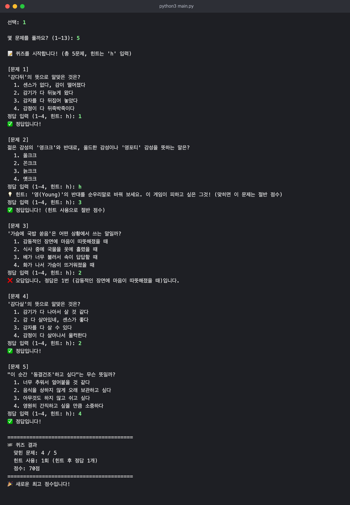
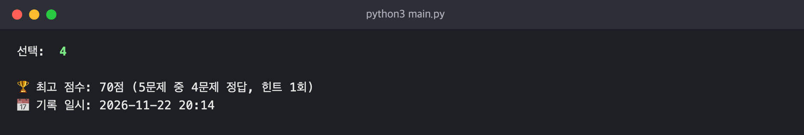

# MZ 신조어 퀴즈 게임

[](https://github.com/ll-0l/E1-2-dev-workstation/actions/workflows/ci.yml)

터미널에서 즐기는 **2026 MZ·잘파세대 신조어** 4지선다 퀴즈 게임입니다.
Python 표준 라이브러리만 사용하며, 추가한 퀴즈와 점수 기록은 `state.json`에 저장되어 프로그램을 다시 실행해도 유지됩니다.

## 목차
1. [프로젝트 개요](#1-프로젝트-개요)
2. [퀴즈 주제와 선정 이유](#2-퀴즈-주제와-선정-이유)
3. [실행 방법](#3-실행-방법)
4. [기능 목록](#4-기능-목록)
5. [파일 구조와 설계](#5-파일-구조와-설계)
6. [데이터 파일 설명 (state.json)](#6-데이터-파일-설명-statejson)
7. [실행 화면](#7-실행-화면)
8. [개발 과정 (Git)](#8-개발-과정-git)
9. [상세 문서 안내](#9-상세-문서-안내)

## 1. 프로젝트 개요

| 항목 | 내용 |
|---|---|
| 형태 | Python 콘솔(터미널) 프로그램 |
| 실행 환경 | Python 3.10 이상, 외부 라이브러리 없음 |
| 핵심 기능 | 퀴즈 풀기 · 추가 · 목록 · 점수 확인 + 보너스(삭제 · 게임 기록 · 랜덤 출제 · 문제 수 선택 · 힌트) |
| 데이터 저장 | 프로젝트 루트의 `state.json` (UTF-8) |
| 구조 | `Quiz` · `QuizSession` · `QuizGame` · `StateStorage` 4개 클래스 + 입력 함수 모듈 `input_utils` |
| 품질 확인 | 단위 테스트 61개, GitHub Actions에서 Python 3.10·3.12·3.13 자동 점검 |

## 2. 퀴즈 주제와 선정 이유

**주제: 2026년 MZ·잘파세대 신조어·유행어**

> MZ세대와 원만하게 소통하기 위한 사전학습. '늙크크'(올드한 감성)가 되지 않기 위한 몸부림입니다.

SNS와 커뮤니티에서는 '감다살', '밤티', '기대컨'처럼 처음 들으면 뜻을 짐작하기 어려운 말이 계속 생겨납니다. 대화에서 매번 뜻을 묻는 대신 게임으로 가볍게 익혀 보려고 이 주제를 골랐습니다.

기본 퀴즈 12개는 아시아투데이 [「2026 상반기 신조어 총정리」](https://www.asiatoday.co.kr/kn/view.php?key=20260723001638281)(2026.07.24)에 실린 표현에서 골랐습니다. 선정 기준(부적절한 표현 제외, 정답 번호 분산, 모든 문제에 힌트)과 교체 절차는 [docs/DESIGN.md 8장](docs/DESIGN.md#8-기본-퀴즈-선정-기준과-교체-절차)에 있습니다.

## 3. 실행 방법

```bash
git clone https://github.com/ll-0l/E1-2-dev-workstation.git
cd E1-2-dev-workstation
python3 --version        # 3.10 이상
python3 main.py
```

- 처음 실행하면 기본 퀴즈 12개로 시작하고 `state.json`을 자동으로 만듭니다.
- 메뉴 `7`로 종료합니다. `Ctrl+C`로 끊어도 저장한 뒤 정상 종료됩니다.

선택 명령:

| 명령 | 용도 |
|---|---|
| `python3 -m unittest discover -s tests -v` | 단위 테스트 61개 실행 |
| `python3 scripts/run_checks.py` | 문법 → 테스트 → 퀴즈 검증 → 실제 실행까지 한 번에 점검 (CI와 동일) |
| `QUIZ_DEBUG=1 python3 main.py` | 잘못된 입력과 저장 결과를 `quiz_debug.log`에 기록 (화면은 그대로) |

## 4. 기능 목록

실행하면 나오는 메뉴 화면입니다.

```text
========================================
         🎯 MZ 신조어 퀴즈 게임 🎯
📂 저장된 데이터를 불러왔습니다. (퀴즈 13개, 최고점수 70점)
========================================
1. 퀴즈 풀기
2. 퀴즈 추가
3. 퀴즈 목록
4. 점수 확인
5. 퀴즈 삭제
6. 게임 기록
7. 종료
========================================
선택:
```

| 번호 | 메뉴 | 설명 |
|---|---|---|
| 1 | 퀴즈 풀기 | 풀 문제 수를 고르면 랜덤 순서로 출제합니다. 답마다 정답/오답을 알려 주고(오답이면 정답 공개), 끝나면 점수를 보여 주고 최고 점수를 갱신합니다. |
| 2 | 퀴즈 추가 | 문제, 선택지 4개, 정답 번호(1-4), 힌트(선택)를 입력받아 등록하고 바로 저장합니다. |
| 3 | 퀴즈 목록 | 등록된 퀴즈를 번호와 함께 보여 줍니다. |
| 4 | 점수 확인 | 최고 점수와 그 판의 정답 수, 힌트 사용 횟수, 기록 일시를 보여 줍니다. |
| 5 | 퀴즈 삭제 | 번호를 고르고 y/n으로 확인한 뒤 삭제합니다. `0`은 취소입니다. |
| 6 | 게임 기록 | 최근 10판을 최신순으로 보여 주고 평균 점수를 함께 표시합니다. |
| 7 | 종료 | 저장한 뒤 종료합니다. |

**점수 규칙**: 문제를 풀다가 `h`를 입력하면 힌트를 볼 수 있습니다. 힌트 없이 맞히면 배점의 100%, 힌트를 보고 맞히면 50%, 틀리면 0점이며 최종 점수는 100점 만점으로 반올림(사사오입)합니다. 예: 5문제 중 4문제 정답, 그중 1문제 힌트 사용 → 70점.

**입력·예외 처리** (상황별 안내 문구와 검증 테스트: [DESIGN 1장](docs/DESIGN.md#1-입력예외-처리), 실제 실행 원문: [RUN_LOG 4장](docs/RUN_LOG.md#4-예외-흐름-사례))
- 숫자 입력은 앞뒤 공백을 지운 뒤 확인하고, 문자(`abc`)·범위 밖 숫자(`9`, `0`)·빈 입력이면 안내 후 같은 질문을 다시 합니다.
- `Ctrl+C`나 입력 스트림 종료(EOF)가 발생해도 안내 문구를 출력하고 저장한 뒤 정상 종료합니다.
- `state.json`이 없으면 기본 퀴즈로 시작하고, 손상됐으면 `state.json.bak`으로 백업한 뒤 기본 퀴즈로 복구합니다.
- 파일을 읽을 수 없거나 더 새로운 버전의 프로그램이 만든 파일이면, 원본을 덮어쓰지 않도록 이번 실행 동안 저장하지 않는 보호 모드로 시작합니다.

## 5. 파일 구조와 설계

```
E1-2-dev-workstation/
├── main.py              # 실행 파일
├── quiz.py              # Quiz: 퀴즈 1개
├── default_quizzes.py   # 기본 퀴즈 12개
├── quiz_session.py      # QuizSession: 퀴즈 한 판 진행
├── quiz_game.py         # QuizGame: 게임 전체 관리
├── storage.py           # StateStorage: state.json 읽기/쓰기
├── input_utils.py       # 입력 검증 함수
├── tests/               # 단위 테스트 61개
├── scripts/             # 점검(run_checks) · 퀴즈 검증 · 백업 복원 · 성능 측정 스크립트
├── docs/                # 상세 문서와 스크린샷 (9장 참고)
├── .github/workflows/   # CI 설정
├── AGENTS.md, CLAUDE.md # 개발 협업 규칙
└── state.json           # 실행 시 자동 생성 (Git 제외)
```

| 클래스 | 책임 | 주요 메서드 |
|---|---|---|
| `Quiz` | 문제 1개의 데이터(문제·선택지·정답·힌트)와 규칙. 생성할 때 형식을 검증 | `display`, `is_correct`, `to_dict`, `from_dict` |
| `QuizSession` | 퀴즈 한 판 진행: 섞기, 출제, 힌트, 채점 후 결과 반환 | `play`, `calculate_score` |
| `QuizGame` | 게임 전체: 메뉴 흐름, 퀴즈 추가·삭제, 최고 점수·기록 관리, 저장 시점 결정 | `run`, `play_quiz`, `add_quiz`, `load`, `save` |
| `StateStorage` | `state.json`을 안전하게 읽고 쓰기. 화면 출력 없이 결과를 상태값으로 반환 | `load`, `save` |

설계 요약 (자세한 내용: [docs/DESIGN.md](docs/DESIGN.md))
- **클래스를 쓴 이유**: 관련 데이터와 동작을 한곳에 묶고, 생성 시점에 잘못된 값을 막고, 실행 중 상태(퀴즈 목록·최고 점수)를 유지하기 위해서입니다. 지킬 상태가 없는 입력 검증은 함수로 두었습니다. → [DESIGN 4장](docs/DESIGN.md#4-클래스를-사용한-이유-함수만-쓸-때와-비교)
- **입력 검증과 데이터 입출력 분리**: 화면 규칙과 저장 방식은 바뀌는 이유가 달라 파일을 나눴고, 덕분에 각각 따로 테스트합니다. → [DESIGN 5장](docs/DESIGN.md#5-입력-검증과-데이터-입출력을-분리한-이유)
- **오류 처리 원칙**: 사용자에게 안내하는 일은 `QuizGame`과 `input_utils`만, 종료 결정은 `QuizGame.run`만 합니다. → [DESIGN 3장](docs/DESIGN.md#3-클래스-역할과-책임)
- **요구사항 변경 시 영향 범위**: 선택지 개수는 `quiz.py`의 `CHOICE_COUNT`, 저장 방식은 `StateStorage`만 바꾸면 되도록 나눴습니다. → [DESIGN 7장](docs/DESIGN.md#7-요구사항-변경-시-영향-범위)
- **테스트**: 테스트 파일별로 검증하는 책임을 정리했습니다. → [DESIGN 6장](docs/DESIGN.md#6-테스트-매핑-책임--테스트)

## 6. 데이터 파일 설명 (`state.json`)

| 항목 | 내용 |
|---|---|
| 경로 | 프로젝트 루트 `./state.json` (`storage.py`와 같은 폴더) |
| 역할 | 퀴즈 목록, 최고 점수, 게임 기록(최근 1,000판)을 보관해 다시 실행해도 유지 |
| 인코딩 | UTF-8 (한글이 그대로 저장됨) |
| 읽기 / 쓰기 | 시작할 때 1회 읽고, 퀴즈 추가·삭제, 한 판 종료, 프로그램 종료 때 씀 |
| 안전 장치 | 임시 파일에 먼저 쓴 뒤 교체해 저장 중 꺼져도 깨지지 않음. 손상되면 `.bak`으로 백업 후 복구 |
| Git | 실행할 때마다 바뀌는 데이터라 `.gitignore`로 제외 |

```json
{
  "version": 1,
  "quizzes": [
    {"question": "'감다살'의 뜻으로 알맞은 것은?",
     "choices": ["감기가 다 나아서 살 것 같다", "감 다 살아있네, 센스가 좋다", "감자를 다 살 수 있다", "감정이 다 살아나서 울컥한다"],
     "answer": 2, "hint": "'감'은 감각·센스를 말해요. 칭찬할 때 써요."}
  ],
  "best_score": 70,
  "best_record": {"played_at": "2026-11-20T19:00:00", "total": 5, "correct": 4, "hints_used": 1, "hinted_correct": 1, "score": 70},
  "history": [
    {"played_at": "2026-11-20T19:00:00", "total": 5, "correct": 4, "hints_used": 1, "hinted_correct": 1, "score": 70}
  ]
}
```

| 필드 | 타입 | 설명 |
|---|---|---|
| `version` | int | 데이터 형식 버전 (현재 1) |
| `quizzes` | list | 퀴즈 목록. 각 퀴즈는 `question`(str), `choices`(str 4개), `answer`(1~4), `hint`(str, 없으면 `""`) |
| `best_score` | int \| null | 최고 점수 0~100. 아직 플레이 전이면 `null` |
| `best_record` | object \| null | 최고 점수를 낸 판의 상세 기록 |
| `history` | list | 게임 기록. 각 기록은 `played_at`(일시), `total`(문항 수), `correct`(정답 수), `hints_used`(힌트 본 문제 수), `hinted_correct`(힌트 보고 맞힌 수), `score`(점수) |

설계 요약 (자세한 내용: [docs/DATA.md](docs/DATA.md))
- **JSON을 고른 이유**: 퀴즈 안의 선택지 목록처럼 중첩된 구조를 그대로 담을 수 있고, 표준 `json` 모듈만으로 처리되며, 사람이 열어 읽을 수 있습니다. CSV·SQLite·pickle과의 비교는 [DATA 6장](docs/DATA.md#6-json을-선택한-이유-다른-방식과-비교).
- **JSON의 한계와 대비**: 저장할 때마다 파일 전체를 다시 쓰므로 기록이 많아지면 느려집니다(실측: 기록 1만 건에 저장 약 0.1초). 그래서 기록을 최근 1,000판으로 제한했고, 동시 실행 보호가 없어 한 폴더에서는 하나만 실행하도록 안내합니다. → [DATA 7·8장](docs/DATA.md#7-json-저장-방식의-한계와-대안)
- **손상·오류 복구**: 불러오기 흐름, 저장 실패 시 조치, 백업 보존 정책과 `scripts/restore_backup.py` 사용법. → [DATA 3~5장](docs/DATA.md#3-불러오기-흐름-quizgameload)
- **버전 업 대비**: `version`과 버전별 변환 함수(`MIGRATIONS`)로 예전 형식 파일을 자동 변환합니다. → [DATA 9장](docs/DATA.md#9-스키마-버전-업-마이그레이션)

## 7. 실행 화면

| 메뉴와 잘못된 입력 처리 | 퀴즈 풀기 |
|---|---|
|  |  |
| 재실행 시 저장 데이터 복원 메시지, `abc`·`9`·빈 입력 재입력 안내 | 정답, 힌트 사용 후 정답, 오답 시 정답 공개, 최고 점수 갱신 |

| 퀴즈 추가 | 점수 확인 |
|---|---|
|  |  |
| 첫 실행 후 퀴즈 추가, 정답 번호 `0` 입력 시 재입력 안내 | 최고 점수와 정답 수·힌트 횟수·기록 일시 |

그 밖의 화면: [퀴즈 목록](docs/screenshots/list.png) · [게임 기록](docs/screenshots/history.png) · [개발 환경](docs/screenshots/dev_env.png) · [git log 그래프](docs/screenshots/git_log.png) · [clone/pull 실습](docs/screenshots/clone_pull.png)
이미지와 같은 실행의 텍스트 원문과 예외 상황별 실행 기록은 [docs/RUN_LOG.md](docs/RUN_LOG.md)에 있습니다.

## 8. 개발 과정 (Git)

- **원격 저장소**: https://github.com/ll-0l/E1-2-dev-workstation (Public)
- **커밋**: 기능 단위 커밋 60개 이상 (`git log --no-merges --oneline | wc -l`). 메시지는 `Feat:` / `Fix:` / `Docs:` / `Refactor:` / `Test:` / `Chore:` 형식입니다.
- **Git 명령어 7종**: `init`, `add`, `commit`, `push`, `checkout`(브랜치 생성·이동), `clone`, `pull`을 모두 사용했습니다.
- **브랜치와 병합**: 기능은 브랜치에서 만들고 `main`에 `--no-ff`로 병합했습니다.

  | 브랜치 | 내용 |
  |---|---|
  | `feature/quiz-model` | Quiz 클래스, 기본 퀴즈 데이터 |
  | `feature/play-quiz` | 퀴즈 풀기 (과제의 브랜치 작업) |
  | `feature/storage` | state.json 저장/불러오기 |
  | `test/storage-integration`, `test/quiz-management` | 회귀 테스트 |
  | `fix/player-qa` | 사용자 QA 반영 |

- **clone / pull 실습**: 별도 폴더로 clone → README 수정 후 commit·push → 원래 폴더에서 pull로 반영하는 과정을 두 번 수행했습니다.
- **자동 점검(CI)**: push마다 GitHub Actions가 Python 3.10·3.12·3.13에서 `scripts/run_checks.py`를 실행합니다.
- **협업**: AI 코딩 에이전트 3개(Claude Code 2개, Codex 1개)가 담당 파일을 나눠 브랜치로 작업했고, 역할과 인터페이스 약속은 [AGENTS.md](AGENTS.md)에 있습니다.

명령 출력 원문(커밋 수, 그래프, 병합 기록, clone/pull 전체 과정, 주요 커밋 해시)은 [docs/GIT_EVIDENCE.md](docs/GIT_EVIDENCE.md), 브랜치 규칙·커밋 기준·충돌 해결 정책은 [docs/CONTRIBUTING.md](docs/CONTRIBUTING.md)에 있습니다.

## 9. 상세 문서 안내

| 문서 | 내용 |
|---|---|
| [docs/DESIGN.md](docs/DESIGN.md) | 입력·예외 처리 표, 안내 문구 형식, 클래스 책임·관계도·오류 전파, 클래스를 쓴 이유, 테스트 매핑, 요구사항 변경 영향 범위, 기본 퀴즈 선정 기준 |
| [docs/DATA.md](docs/DATA.md) | `state.json` 저장 시점, 필드 설계 의도, 불러오기·저장 흐름, 백업·복구, JSON 선택 이유와 한계, 성능 측정, 운영 지침, 마이그레이션 |
| [docs/RUN_LOG.md](docs/RUN_LOG.md) | 실행 화면 텍스트 원문과 예외 상황별 실행 기록 |
| [docs/GIT_EVIDENCE.md](docs/GIT_EVIDENCE.md) | Git 작업 증빙 (원격 저장소, 커밋, 브랜치·병합, clone/pull) |
| [docs/CONTRIBUTING.md](docs/CONTRIBUTING.md) | 브랜치 이름 규칙, 커밋 기준과 템플릿, 리뷰 체크리스트, 충돌 해결 정책 |
| [docs/PEER_REVIEW.md](docs/PEER_REVIEW.md) | 평가 항목별 대응표와 답변 (쉬운 말 버전: [PEER_REVIEW_EASY.md](docs/PEER_REVIEW_EASY.md)) |
